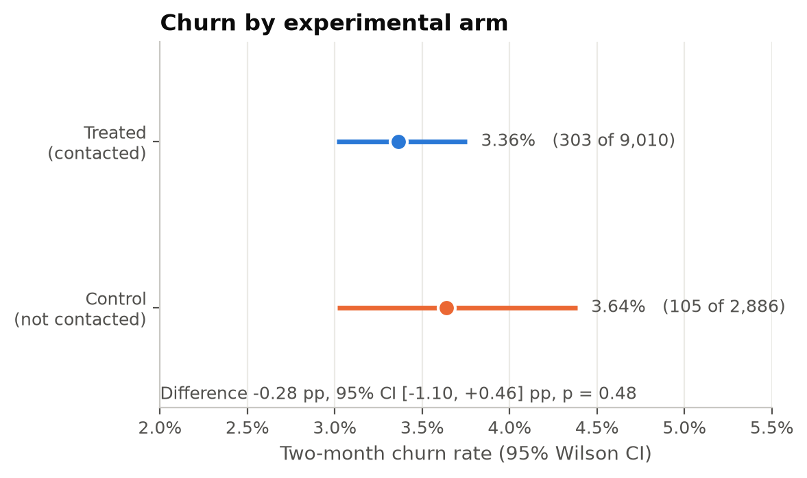
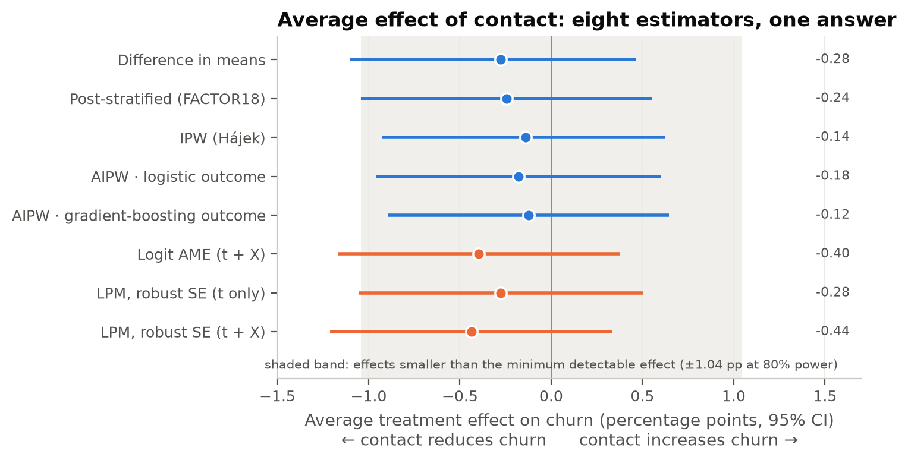
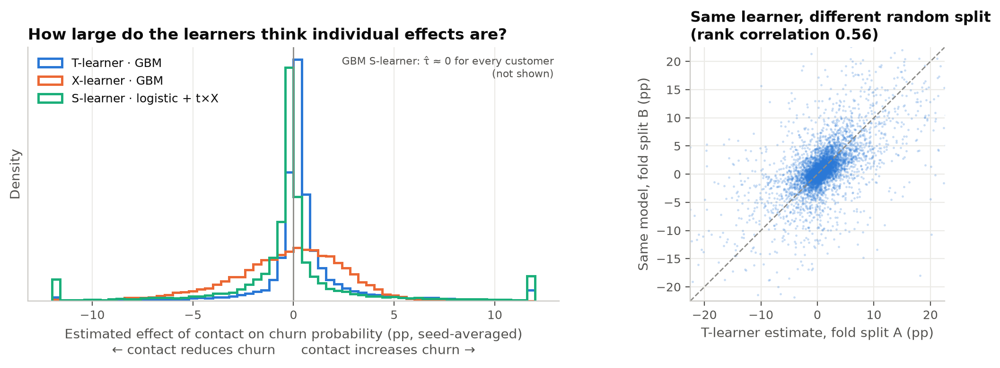
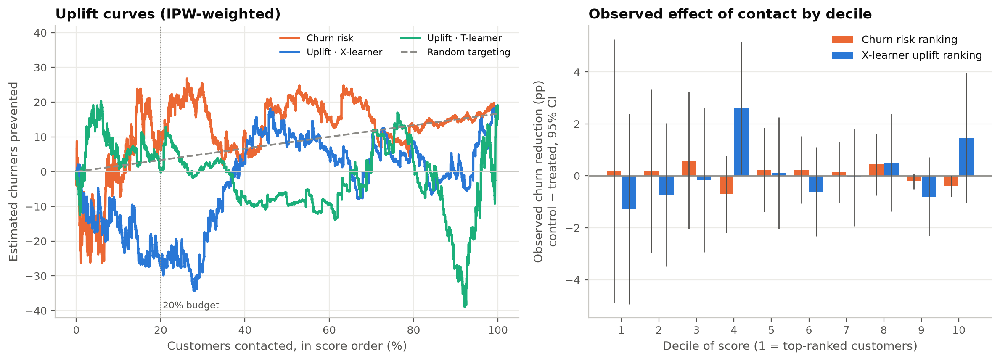
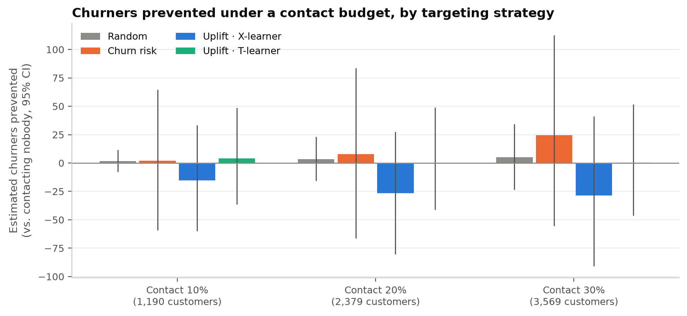

# Causal Machine Learning for Customer Retention

**Estimating the effect of a retention campaign and testing whether uplift modelling can find the customers worth contacting.**

Python · statistics · causal inference · econometrics · machine learning · SQL

---


| Question | Finding |
|---|---|
| Did the retention contact reduce churn? | **Not detectably.** Churn was 3.36% for contacted customers vs 3.64% for the control group: −0.28 pp, 95% CI [−1.10, +0.46], p = 0.48. Eight different estimators agree. |
| Could the experiment have detected a real effect? | Only a large one. It had 80% power for effects of ≈ 1 pp (a ~29% cut in churn) and ~11% power for the effect actually observed. |
| Do some customers respond more than others? | No reliable evidence. Interaction tests, subgroup analysis and three causal-ML meta-learners find nothing that survives validation. |
| Does uplift targeting beat churn-risk targeting? | **No.** At a 20% contact budget, no strategy (random, churn risk or uplift) is statistically distinguishable from any other. The uplift models do not beat random targeting (permutation p ≈ 0.8). |
| Recommendation | Don't deploy the uplift model, and don't write off the campaign. Run a larger, cleaner experiment (sizing below) and validate any targeting rule prospectively. |

The headline is a **null result, analysed carefully**. The project's value is in showing *why* the data cannot support individual targeting, and what evidence would.

---

## 1. Business problem

Retention teams have limited capacity: only a fraction of customers can be called or sent an offer. The usual approach is to contact the customers **most likely to churn**. That is not the same as contacting the customers **whose decision will change because of the contact**:

| Group | Without contact | With contact | Worth contacting? |
|---|---|---|---|
| Persuadables | churn | stay | ✅ the only group where contact prevents churn |
| Sure things | stay | stay | ❌ wasted contact |
| Lost causes | churn | churn | ❌ wasted contact |
| Sleeping dogs | stay | churn | ❌ contact causes churn |

A churn model ranks persuadables and lost causes together. **Uplift modelling** tries to find the persuadables. This project tests whether that works on real experimental data.

## 2. Research question

> If a company can contact only a limited share of customers, which customers should it target to maximise the **incremental** reduction in churn?

Secondary questions: Does the intervention have a causal effect (ATE)? Does the effect vary across customers (CATE)? Does uplift targeting outperform churn-risk targeting under a 10–30% budget?

## 3. Dataset

**Orange Belgium churn-uplift benchmark** ([Verhelst et al., 2023](https://arxiv.org/abs/2312.07206); [OpenML 45580](https://www.openml.org/search?type=data&id=45580); CC BY-NC-ND 4.0, downloaded at run time and not redistributed). Full documentation is in [`data/README.md`](data/README.md).

- **11,896 customers** from retention campaigns run September–December 2020 by a Belgian telecom operator. It is one of very few public datasets from a *real* randomised retention experiment.
- **Treatment `t`:** call-centre contact with a retention offer (75.7% treated, 24.3% held-out control).
- **Outcome `y`:** churn within two months (1 = churned). There are **408 churners in total, only 105 of them in the control group**.
- **Covariates:** 160 PCA-anonymised numeric features and 18 anonymised categorical features.

> It is a telecom dataset rather than banking data, but the analytical problem (an experiment, then an effect, heterogeneity and targeting) is the same one a bank faces when retaining current-account or mortgage customers.

## 4. Causal framework

- Each customer has two **potential outcomes**: `Y(1)` if contacted and `Y(0)` if not. The **individual effect** `Y(1) − Y(0)` is never observable, because each customer either was or wasn't contacted. This is the fundamental problem of causal inference.
- The **average treatment effect** `ATE = E[Y(1) − Y(0)]` *is* identifiable when treatment is independent of potential outcomes, which is what randomisation provides.
- The **conditional average treatment effect** `τ(x) = E[Y(1) − Y(0) | X = x]` describes how the effect varies with customer characteristics. Uplift targeting ranks customers by an estimate of it.
- **A finding that shaped the analysis:** treatment was *not* assigned with equal probability to all customers. The treated share ranges from 63% to 86% across segments, consistent with pooled campaigns using different treatment/control ratios. The analysis therefore assumes randomisation **conditional on covariates** and adjusts for them throughout.

## 5. Methodology

| Notebook | What it does |
|---|---|
| [01 Data understanding](notebooks/01_data_understanding.ipynb) | Identifies T/Y/X, checks data quality, builds the data dictionary and causal structure, gives the first evidence of uneven assignment |
| [02 Exploratory analysis](notebooks/02_exploratory_analysis.ipynb) | Distributions, churn drivers, covariate balance (SMD), **SQL** joins and segment summaries |
| [03 Experimental analysis](notebooks/03_experimental_causal_analysis.ipynb) | Difference-in-means ATE, Newcombe and bootstrap CIs, **power / minimum detectable effect**, propensity model chosen by balance, **IPW and doubly robust (AIPW)** estimates |
| [04 Regression](notebooks/04_regression_analysis.ipynb) | Logistic models (baseline, then + T, + X, + T×X), odds ratios, **average marginal effects**, robust LPM, LR test for interactions, subgroup effects |
| [05 Causal ML](notebooks/05_causal_machine_learning.ipynb) | **S-, T- and X-learners**, cross-fitted. **Validated on simulated data with a known effect** first, then fitted to the real data with a stability analysis across random splits |
| [06 Uplift evaluation](notebooks/06_uplift_evaluation.ipynb) | Decile analysis, uplift and Qini curves, permutation tests, **budget-constrained comparison** of random vs churn-risk vs uplift targeting, robustness, recommendation |

Principles applied throughout:
- **Pre-specification.** Regression covariates and interactions were fixed before looking at treatment effects. The propensity model was chosen on covariate balance alone, without looking at outcomes.
- **Out-of-sample everything.** Every propensity, outcome prediction and CATE is cross-fitted, so no customer is scored by a model that saw them.
- **Test the method before trusting it.** The meta-learners were run on synthetic experiments with a planted effect, to separate "there is no heterogeneity" from "the method can't find it".

## 6. Results

### The average effect is small and statistically indistinguishable from zero





Eight estimators give the same answer: the raw comparison, post-stratification, IPW, two doubly robust variants, a logit average marginal effect, and two linear probability models. All point estimates lie between −0.13 and −0.44 pp, and every 95% interval crosses zero. The shaded band shows effects smaller than the experiment's **minimum detectable effect (±1.04 pp at 80% power)**. Detecting an effect of −0.28 pp reliably would require roughly **70,000 customers per arm**.

Adjusting for the uneven assignment matters methodologically. Propensity weighting brings every covariate within |SMD| < 0.1 ([figure](figures/fig3_covariate_balance.png)). It barely moves the estimate, however, because the variables that drove assignment are only weakly related to churn.

### No reliable heterogeneity

- The pre-specified treatment × covariate interactions are jointly non-significant (LR test p = 0.76). Subgroup effects are consistent with one common effect (Cochran's Q p = 0.59 and 0.19; [figure](figures/fig5_subgroup_effects.png)).
- **Causal ML on simulated data:** with strong heterogeneity, all learners recover it (correlation with the true effect 0.55–0.72). When the effect is scaled down to this experiment's size (≈ −0.3 pp), **no learner beats random targeting** even though real heterogeneity exists by construction.
- **Causal ML on the real data:** each learner fails in its own instructive way. The gradient-boosting S-learner ignores treatment entirely (τ̂ = 0, regularisation bias). The logistic S-learner overfits (±80 pp "effects"). The T-learner is biased (mean +0.6 pp vs an ATE of −0.3 pp). The X-learner, designed for unbalanced arms, is the most coherent. Even so, retraining with a different random split changes the "top 20% persuadables" list by almost half.



## 7. Uplift evaluation



- **Churn-risk targeting finds churners** (AUC 0.85, 19% churn in the top decile), but in that top decile contacted and control customers churned at the same rate (18.8% vs 19.0%). They behave like lost causes.
- **Uplift targeting finds nothing usable.** The X-learner's top decile churned *more* when contacted (−1.3 pp), its uplift curve sits below random for most of the first 40%, and the permutation test against random rankings gives p ≈ 0.8.



**Churners prevented at a 20% contact budget (2,379 customers), IPW-weighted, 95% bootstrap CI:**

| Strategy | Point estimate | 95% CI |
|---|---|---|
| Random | ≈ 3 | −16 to +23 |
| Churn risk | ≈ 8 | −66 to +84 |
| Uplift · X-learner | ≈ −26 | −80 to +27 |
| Uplift · T-learner | ≈ 0 | −41 to +49 |

**Uplift-based targeting did not outperform churn-risk targeting.** None of the four strategies can be distinguished from the others or from zero. The overfit logistic S-learner (not shown) was the only strategy clearly *worse* than doing nothing.

## 8. Business recommendation

1. **Effectiveness:** the campaign has no demonstrable effect on two-month churn (−0.28 pp, 95% CI −1.10 to +0.46). Large benefits and large harms are ruled out. A modest benefit is not.
2. **Responsive customers:** they cannot be identified from this data. Apparent segment differences are within noise.
3. **Targeting:** don't deploy the uplift model. If a campaign must run, prioritise by churn risk as a *working assumption*. If the effect is a constant relative reduction (estimated risk ratio 0.92), high-risk customers yield more absolute reduction per call: ~24 vs ~7 churners prevented per 2,379 contacts. The experiment neither confirms nor refutes this assumption.
4. **Economics:** at −0.28 pp, about 3 churners are prevented per 1,000 calls. A call pays off only if it costs less than ~0.3% of a retained customer's value.
5. **Before deploying any targeting rule:**
   - Run a larger experiment with a single allocation ratio or explicit stratification, recording the campaign, the offer and whether the customer was reached. About 70k customers per arm are needed for the average effect, and more for heterogeneity.
   - Validate an uplift model *prospectively*, by randomising within its top-ranked customers in a new trial.
   - Use interpretable features, so that responsive segments can be hypothesised in advance and acted upon.

## 9. Limitations

- **Assignment:** randomisation appears to be conditional on segment. Adjustment handles observed drivers but cannot handle unrecorded ones (e.g. agent discretion).
- **Few events:** with 105 control churners, every heterogeneity analysis is underpowered.
- **Treatment heterogeneity:** "contact" bundles different offers, scripts and agents. Whether customers were actually reached is not recorded, so the estimate is an intention-to-treat effect.
- **Interference (SUTVA):** customers sharing a household or contract could influence each other.
- **Short outcome window:** two months misses delayed effects.
- **External validity:** Belgian telecom customers in late 2020, not bank customers.
- **Anonymised features:** even a real responsive segment could not be explained to a business team.

The full discussion is in [notebook 06 §7](notebooks/06_uplift_evaluation.ipynb).

## 10. Future work with real banking data

- Design the retention experiment around the decision: stratify by product and segment, record offer type and contact outcome, and size it from a power calculation using the bank's own churn base rate.
- Model **value**, not just churn: incremental retained balance or margin net of contact cost, which turns uplift into profit-uplift.
- Use interpretable, pre-treatment features (tenure, product holdings, digital engagement, complaints, rate changes) and pre-register candidate effect modifiers.
- Add causal forests with honest confidence intervals for CATEs, plus policy-learning methods that optimise a contact rule directly under a budget, but only once the data has enough events to support them.

---

## Repository structure

```
├── data/
│   └── README.md            # source, licence, data dictionary, limitations
├── notebooks/               # 01–06, executed with outputs
├── sql/
│   └── customer_summary.sql # joins, segment summaries, NTILE decile analysis
├── src/
│   └── functions.py         # data loading, estimators, meta-learners, uplift metrics, plotting
├── figures/                 # final figures
└── requirements.txt
```

## Reproducing the analysis

```bash
python3.12 -m venv .venv && source .venv/bin/activate
pip install -r requirements.txt
# Notebooks must run in order: 03 writes the propensity scores and 05 the CATEs used later.
for nb in notebooks/0*.ipynb; do jupyter nbconvert --to notebook --execute --inplace "$nb"; done
```

The first run downloads the dataset from OpenML into `data/raw/` (git-ignored). All models use fixed seeds.
